# automatic-boss-delivery

**BOSS 直聘自动投递助手** —— 登录、找职位、简历匹配、AI 写招呼语、一键投递，一条龙跑通,协议全部走真实接口。

```
登录 ──► 找职位 ──► 简历匹配 ──► AI 写招呼语 ──► 一键投递
```

> 后续会更新其他平台
---

## 下载

到 Releases 页面的 **Assets** 里下 `BossAutoDelivery-x.y.z.zip`，无需 Python：

| 来源 | 地址 |
|------|------|
| **GitHub** | https://github.com/handsomekai924/boss-automatic-delivery/releases |
| **Gitee**（国内更快） | https://gitee.com/w-kev/boss-automatic-delivery/releases |

装好后有新版本会在网页里提示，点「立即更新」就地升级。

---

## 安装

**打包版**：解压到任意目录即装好，数据就存在解压目录的 `data\` 里（换机器整个文件夹拷走）。

**源码版**：

```bash
git clone https://github.com/handsomekai924/boss-automatic-delivery.git
cd boss-automatic-delivery
python -m venv .venv
# Windows:  .venv\Scripts\activate
# macOS / Linux:  source .venv/bin/activate
pip install -r requirements.txt
```

环境：Python 3.10+（打包版不需要）、Chrome 浏览器、一个能收短信的手机号。

---

## 启动

**打包版**：双击 `BossAutoDelivery.exe`。

**源码版**：

```bash
python -m boss_web
# 默认 http://127.0.0.1:8787 ，浏览器自动打开
```

打开后按页面顺序走：登录 → 找职位 → 上传简历 → AI 设置 → 看匹配 → 一键投递。

---

## 界面预览

### 概览页
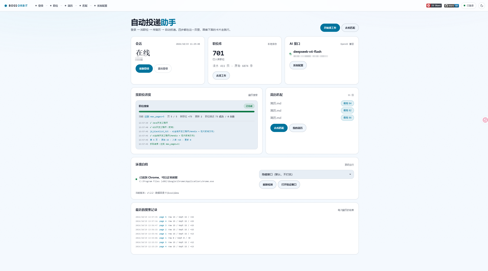

### 登录
短信验证码 / APP 扫码，滑块由你本人拖动官方组件。
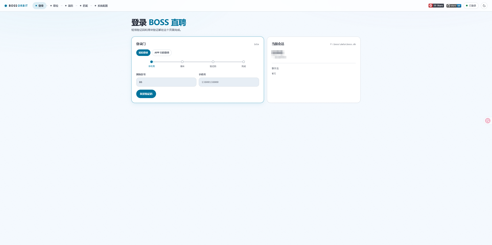

### 找职位
按条件分页抓取、卡片化浏览、选中即抓 JD。
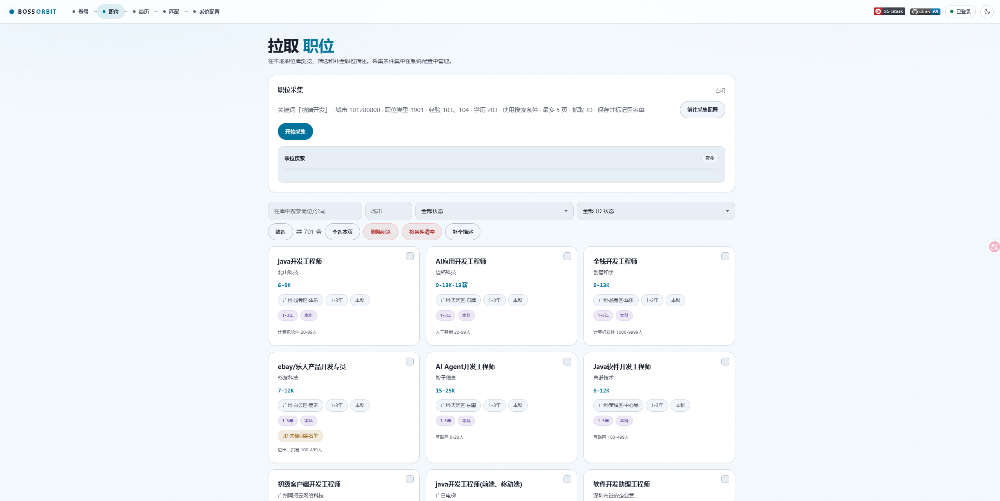

### 上传简历
Word / PDF / Markdown / 纯文本，AI 自动解析成结构化结果。
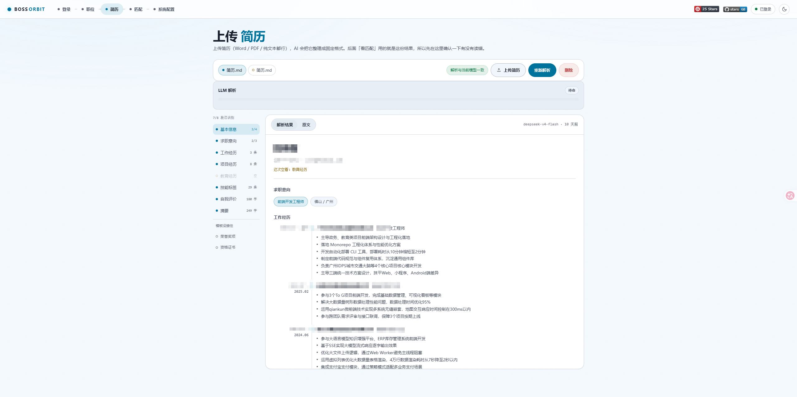

### AI 设置
OpenAI 兼容协议（DeepSeek / Kimi / 本地 vLLM 都行），Key 只存本地。
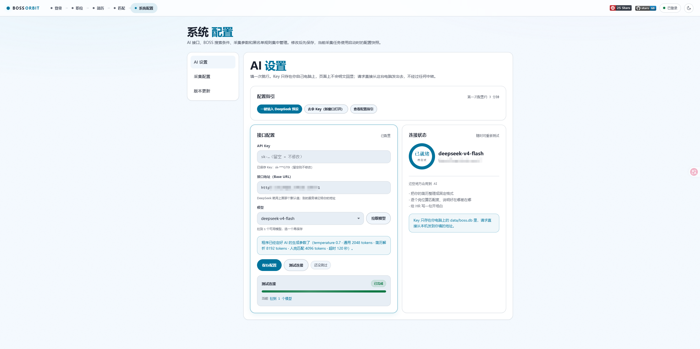

### 采集配置
城市 / 求职类型 / 薪资 / 经验 / 学历 / 行业 / 规模，含黑名单规则。
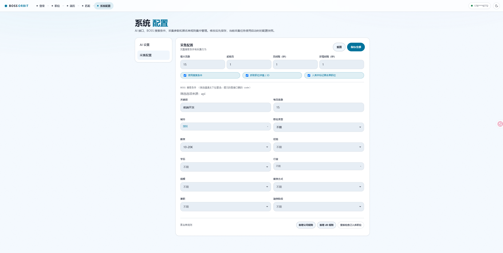

### 匹配工作台
一键匹配，AI 出匹配度、优缺点与个性化招呼语。
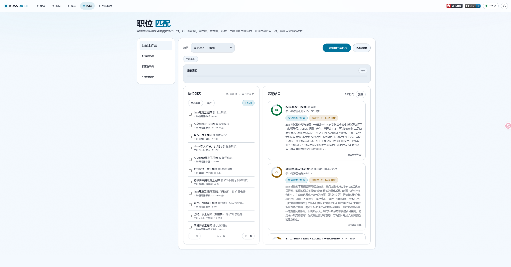

### 批量发送
一键发送全部 / 选中，带评分阈值与发送清单。
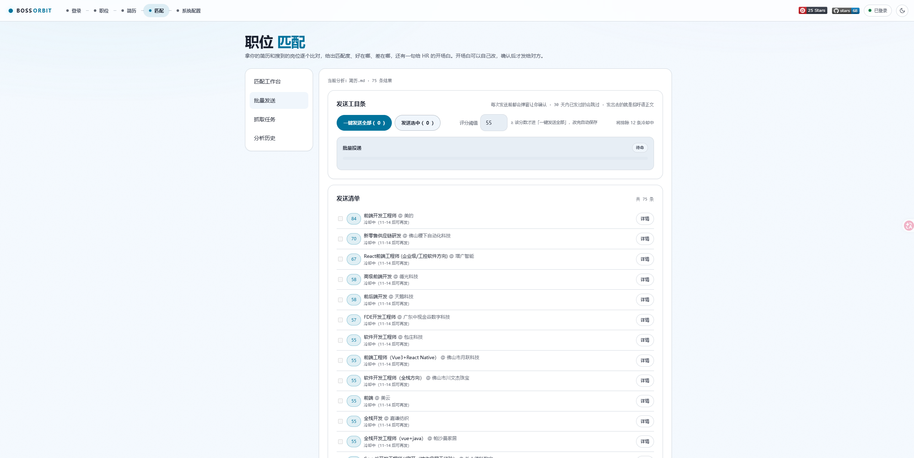

### 抓取任务
每次抓取留档，可回看条件、统计与本批岗位。
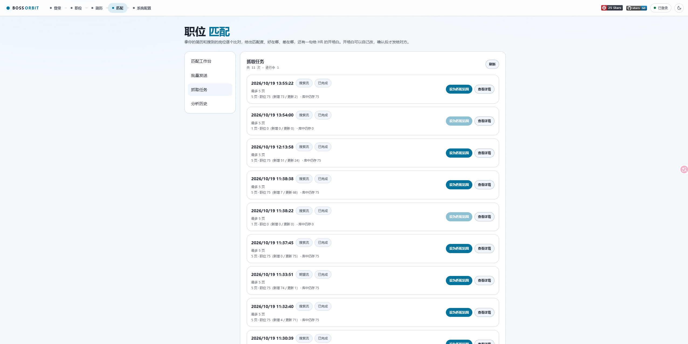

### 分析历史
历史匹配结果载入 / 删除。
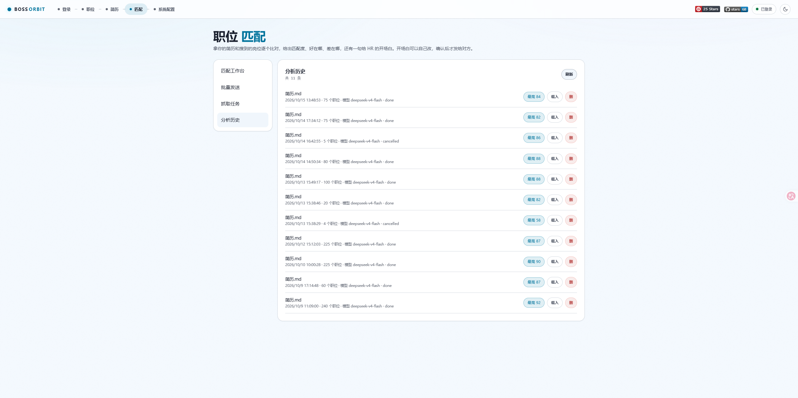

### 匹配详情
点开卡片看分析全文，底部可改招呼语并发送。
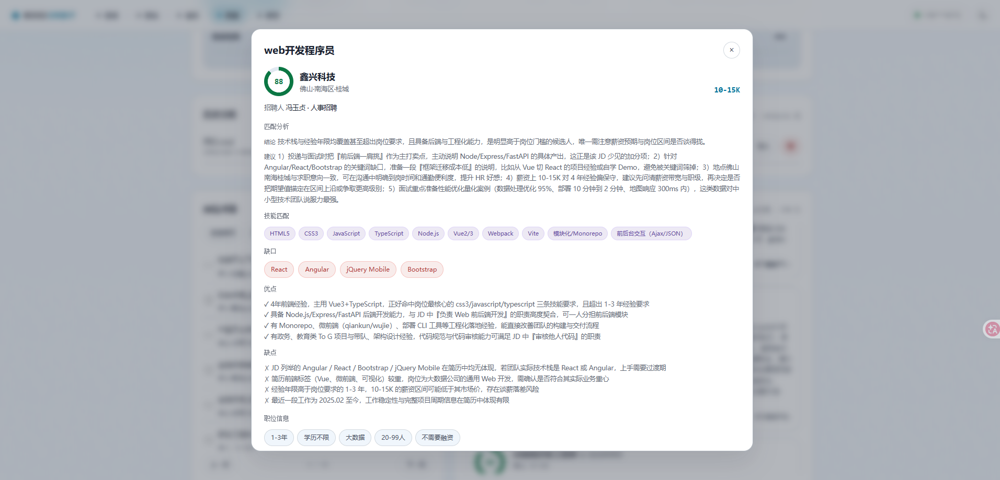

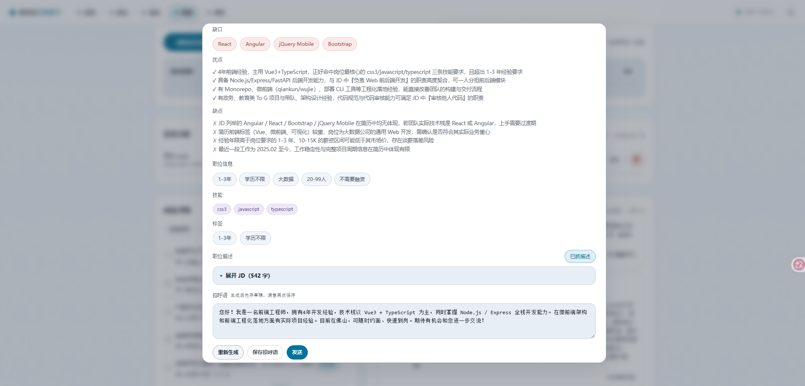

### 版本更新
手动检测、就地看更新日志、一键复制诊断信息。
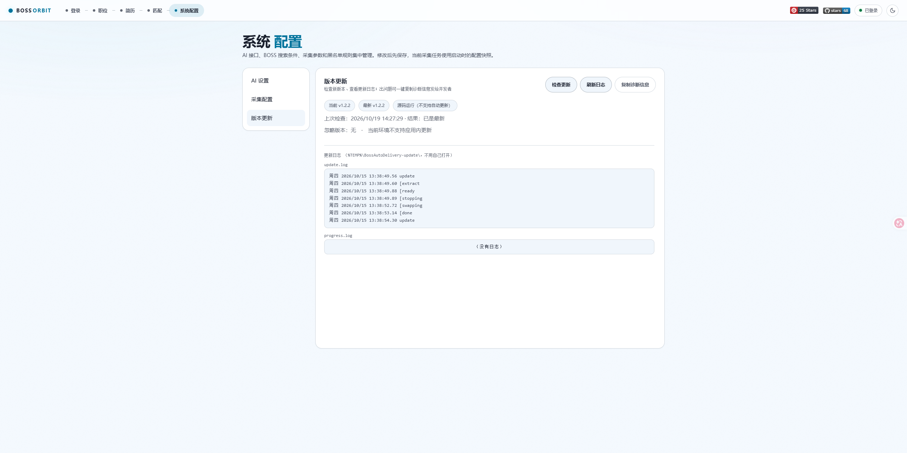

---

## 后续规划

- [X] 自定义打招呼提示词
- [X] 简历多版本管理与针对性优化
- [X] 岗位专属面试题生成
- [ ] 全流程全自动模式并添加定时任务定时发送
- [ ] 投递策略优化（时间段、频率控制）
- [ ] 支持更多招聘平台（拉勾、猎聘、前程无忧等）

---

## 免责声明

本项目仅供**学习与技术研究**使用。使用即表示你同意：

1. 遵守 BOSS 直聘的用户协议与法律法规，账号行为自负
2. 不得用于批量骚扰、数据倒卖或任何商业牟利用途
3. 控制抓取频率，不要对目标站点造成压力
4. 因使用本项目导致的任何账号限制、封禁或法律后果，作者不承担责任

若平台方认为本项目不妥，联系即下架。

License: MIT
